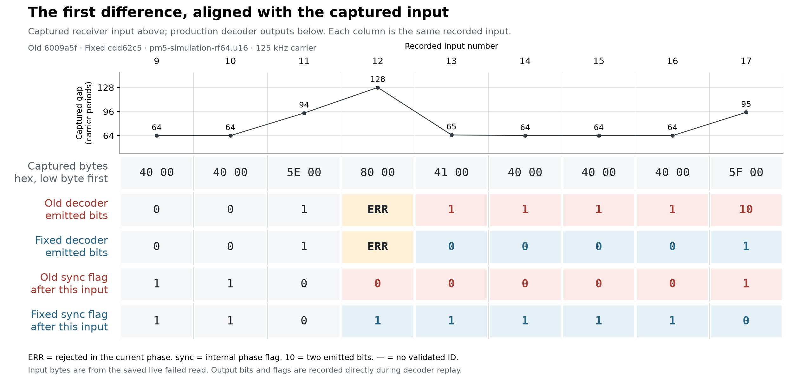
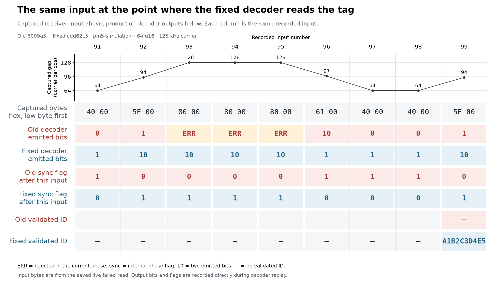

# EM410x decoder captures

The two figures replay the same captured receiver input through the original decoder and the reset fix. Each column keeps the recorded input, emitted bits and internal phase flag aligned. These are rising-edge interval measurements, not an analogue waveform.





The fix and regression fixtures are in [cdd62c5](https://github.com/adrian-stepien/ChameleonUltra/commit/cdd62c5). The original decoder is from upstream `6009a5f`. The fix branch includes the complete interval payloads and live results for both pairs below, plus the host regression test.

| Pair | Original live result | Fixed live result |
| --- | --- | --- |
| Same physical T5577, EM4100 ID 1020304050 | Correct ID at input 545, 330 ms | Correct ID at input 56, 30 ms |
| Same PM5 simulation profile, EM4100 ID A1B2C3D4E5 | No tag in 762 inputs, 510 ms | Correct ID at input 99, 60 ms |

`live-captures` contains the full diagnostic responses and their read metadata. All IDs are synthetic. The first 48 bytes of each `.emtrace` are the recording header; the remainder is the unmodified little-endian uint16 interval payload checked into the fix branch. Both firmware builds used identical temporary recording instrumentation. All four captures have zero dropped or truncated inputs.

The header format is `<4sHHIIIIH15s7x`: magic `EMR1`, status, interval count, ring drops, trace truncation count, duration in ms, first-result time in ms, first-result interval count and 15-byte tag result. The final seven bytes are reserved. A first-result time of `FFFFFFFF` means no result. The tag result uses a big-endian two-byte type followed by native tag bytes. Header times have 10 ms resolution.

To reproduce the figures, keep a checkout of `dev/chameleon-em4100-reader` and a copy of this assets branch in separate folders. Run:

```sh
python3 replay_aligned_outputs.py --repo /path/to/ChameleonUltra
python3 plot_aligned_outputs.py --repo /path/to/ChameleonUltra
```

The first command compiles the production decoder at both pinned revisions with the test's Nordic header stubs and records its actual output bits and phase state. It needs Python 3 and a host C compiler. The second command needs Matplotlib. Neither command contacts hardware or writes to the source checkout. `aligned-capture/source.json` records the revisions and raw input hash; `aligned.csv` contains all 762 aligned inputs.

Run `python3 software/script/tests/test_em410x_decoder.py` from the fix checkout for the four live recordings, the physical-card offset case and generated RF/16, RF/32 and RF/64 phase checks.
